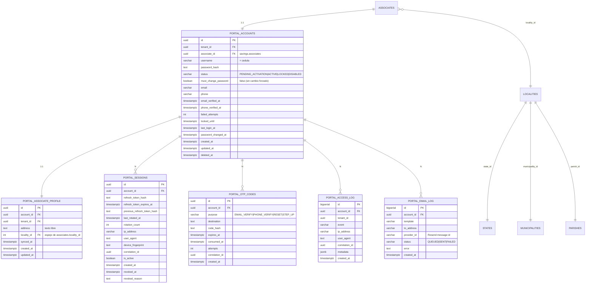

# 01 · Modelo de datos — esquema `portal`

## 1. Principios

- El portal **no duplica** los datos del ERP: los **lee** de `savings.*` / `core.*`.
- El esquema `portal` es dueño únicamente de: **cuentas de acceso, sesiones, OTP, perfil
  (dirección) y log de acceso**.
- La **fuente de verdad** de los datos del asociado sigue siendo el ERP (`savings.associates`).
- Sólo `phone`, `email` y `locality_id` de `savings.associates` son escribibles por el portal,
  y **a nivel de columna** (ver grants).

## 2. Modelo de localidad (ERP, catálogos globales `core`)

```
core.states (id serial, name)
   └── core.municipalities (id serial, name, state_id → states.id)
          └── core.parishes (id serial, name, municipality_id → municipalities.id)

core.localities (id serial, state_id, municipality_id, parish_id, name UNIQUE)
   UNIQUE(state_id, municipality_id, parish_id)

savings.associates.locality_id → core.localities.id
```

**Estado + Municipio + Parroquia ⇒ una `locality` ⇒ `localityId`**, que es el valor que se
persiste en el ERP. El portal resuelve el `localityId` a partir de la cascada seleccionada por
el asociado.

> La **dirección** (texto libre) no existe en `savings.associates`: se guarda en
> `portal.associate_profile.address`.

## 3. ERD



## 4. Especificación de tablas

### 4.1 `portal.accounts`
Cuenta de acceso del asociado (realm portal). **No** otorga permisos de staff.

| Columna | Tipo | Notas |
|---|---|---|
| `id` | uuid PK | `gen_random_uuid()` |
| `tenant_id` | uuid | FK `tenant.tenants(id)` |
| `associate_id` | uuid | FK `savings.associates(id)` |
| `username` | varchar(20) | = cédula |
| `password_hash` | text | bcrypt (vía `SecurityService`) |
| `status` | varchar(20) | `PENDING_ACTIVATION` \| `ACTIVE` \| `LOCKED` \| `DISABLED` |
| `must_change_password` | boolean | `false` por decisión de negocio |
| `email` / `phone` | varchar | espejo informativo del contacto |
| `email_verified_at` / `phone_verified_at` | timestamptz | verificación por OTP |
| `failed_attempts` | int | control de lockout |
| `locked_until` | timestamptz | bloqueo temporal |
| `last_login_at` | timestamptz | último ingreso |
| `password_changed_at` | timestamptz | auditoría de cambio opcional |
| `created_at` / `updated_at` / `deleted_at` | timestamptz | |

Índices únicos (parciales, `WHERE deleted_at IS NULL`): `(tenant_id, associate_id)`,
`(tenant_id, username)`.

### 4.2 `portal.associate_profile`
Extensión de perfil no soportada por el ERP (dirección libre).

| Columna | Tipo | Notas |
|---|---|---|
| `id` | uuid PK | |
| `account_id` | uuid UNIQUE | FK `portal.accounts(id)` 1:1 |
| `tenant_id` | uuid | FK `tenant.tenants(id)` |
| `address` | text | dirección completa (texto libre) |
| `locality_id` | int | FK `core.localities(id)`, **espejo** de `associates.locality_id` |
| `synced_at` | timestamptz | última sincronización con el ERP |

### 4.3 `portal.sessions`
Motor de sesión espejo del ERP, con **realm propio**. Diferencia clave: **no se almacena el
refresh token en claro** (solo su hash), corrigiendo el hallazgo R3 del ERP.

| Columna | Tipo | Notas |
|---|---|---|
| `id` | uuid PK | |
| `account_id` | uuid | FK `portal.accounts(id)` |
| `refresh_token_hash` | text | hash del refresh |
| `refresh_token_expires_at` | timestamptz | |
| `previous_refresh_token_hash` | text | detección de reuso |
| `last_rotated_at` / `rotation_count` | | rotación |
| `ip_address` / `user_agent` / `device_fingerprint` | | contexto |
| `correlation_id` | uuid | trazabilidad |
| `is_active` / `revoked_at` / `revoked_reason` | | revocación |

### 4.4 `portal.otp_codes`
OTP para verificación de email/teléfono, recuperación y step-up.
`purpose`: `EMAIL_VERIFY` \| `PHONE_VERIFY` \| `RESET` \| `STEP_UP`.
Reglas: TTL 10 min, máx. 5 intentos, un solo uso (`consumed_at`), hash del código (nunca en claro).

### 4.5 `portal.access_log`
Bitácora del portal. Alternativa: reutilizar `audit.audit_events` del ERP.
`event`: `LOGIN` \| `LOGIN_FAILED` \| `LOGOUT` \| `READ` \| `PROFILE_UPDATE` \|
`PASSWORD_CHANGE` \| `OTP_SENT`.

### 4.6 `portal.email_log` (opcional, recomendada)
Registro de envíos vía **Resend** para observabilidad y reintentos:
`template`, `to_address`, `provider_id` (message id de Resend), `status`, `error`.

## 5. Flujo de aprovisionamiento (carga mensual)

```
Carga mensual de asociados/haberes (ERP)
   └── se crea/actualiza un asociado  →  emite dominio `associate.created`
          └── (outbox/event-bus existente)
                 └── Listener de aprovisionamiento (idempotente, upsert):
                        portal.accounts(
                          username = cedula,
                          password_hash = hash(cedula),
                          status = 'ACTIVE',
                          must_change_password = false
                        )
                        portal.associate_profile( address = null, locality_id = associates.locality_id )
```

- **Idempotente** por `(tenant_id, associate_id)`.
- Desacoplado por evento para **no romper** la carga si el aprovisionamiento falla (reintentos).
- **Backfill único** para los asociados existentes.
- Se envía correo de alta (Resend) con instrucciones de acceso y recomendación de cambiar la
  contraseña (opcional).

## 6. Reglas de negocio de edición

| Campo | Editable | Destino | Requiere OTP |
|---|---|---|---|
| `phone` | sí | `savings.associates.phone` | sí (`PHONE_VERIFY`) |
| `email` | sí | `savings.associates.email` | sí (`EMAIL_VERIFY`) |
| `locality_id` | sí | `savings.associates.locality_id` | no |
| `address` | sí | `portal.associate_profile.address` | no |
| `fullname`, `cedula`, `nationality`, `birthdate`, `base_salary`, `job_title`, `status` | **no** | — | — |
| saldos, movimientos, préstamos, créditos | **no** (solo lectura) | — | — |

## 7. Notas de implementación

- El esquema se define en **Drizzle ORM** (TypeScript) y la migración se **genera** con
  `drizzle-kit`; ver [`04-esquema-drizzle.md`](./04-esquema-drizzle.md) y el esquema de
  referencia [`drizzle/portal.schema.reference.ts`](./drizzle/portal.schema.reference.ts).
- [`ddl/portal-schema.sql`](./ddl/portal-schema.sql) es solo la salida **de referencia**
  esperada de `drizzle-kit generate` (no se ejecuta a mano).
- Permisos del rol `portal_app`: [`ddl/portal-role-grants.sql`](./ddl/portal-role-grants.sql),
  aplicados como **migración custom** (drizzle-kit no gestiona roles/GRANTs).
